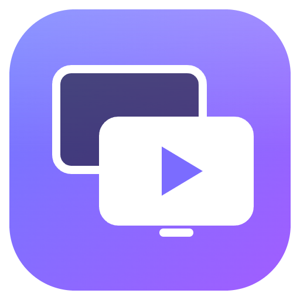
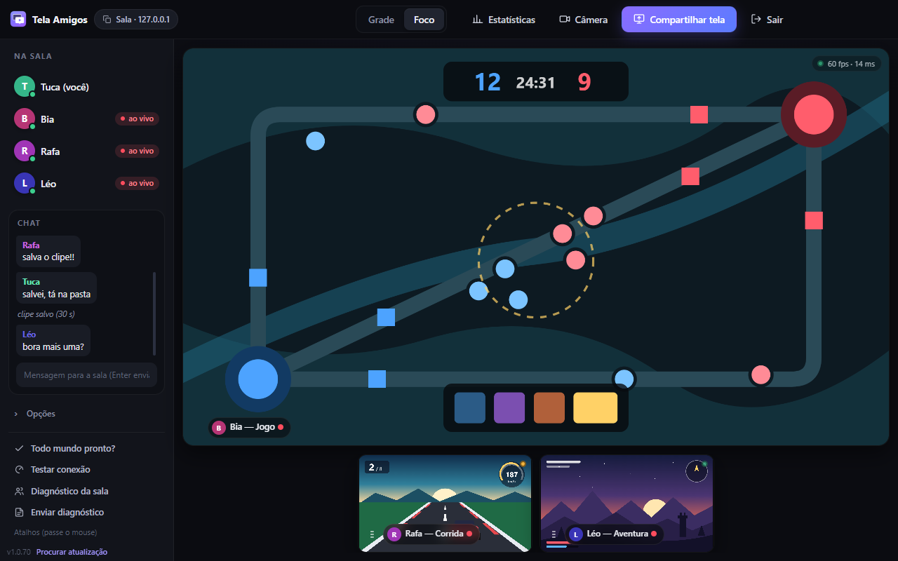
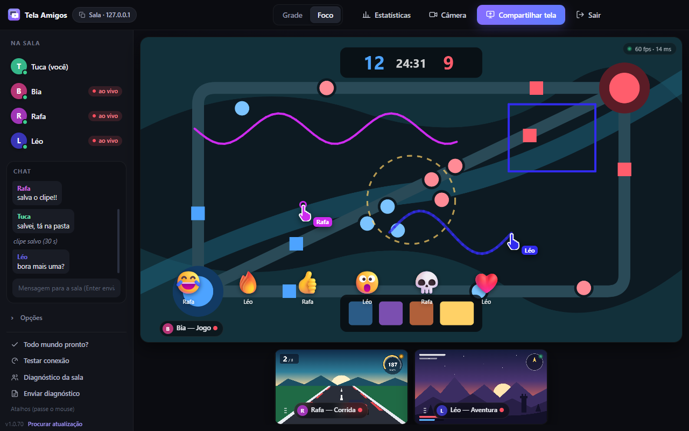
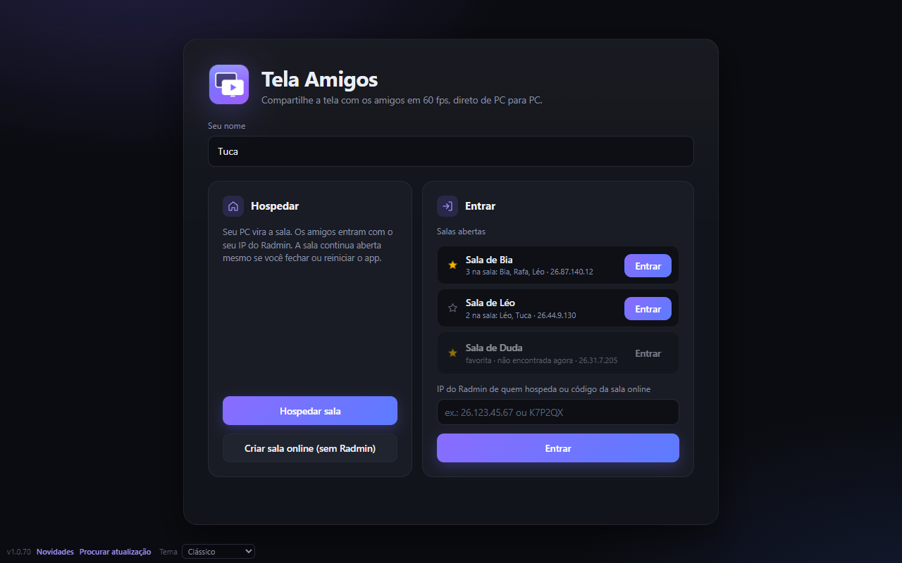
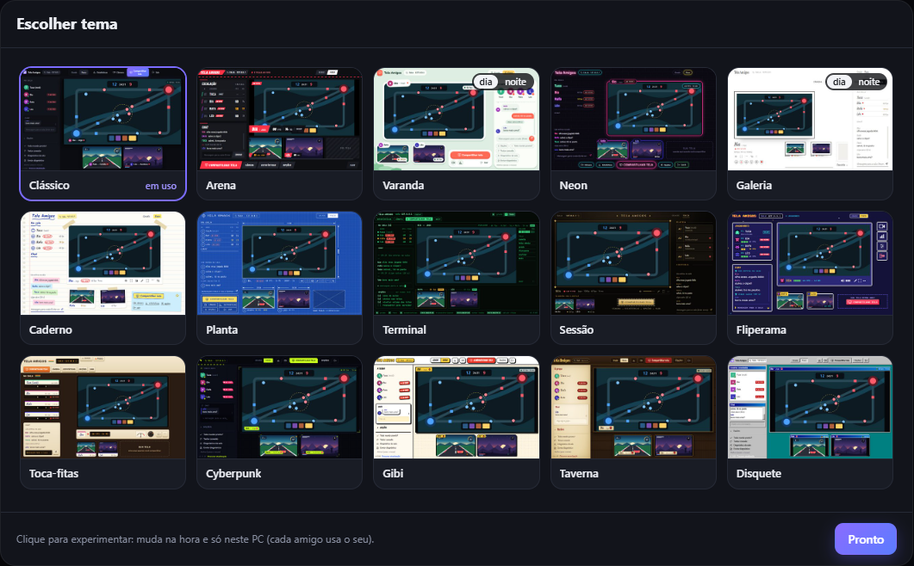
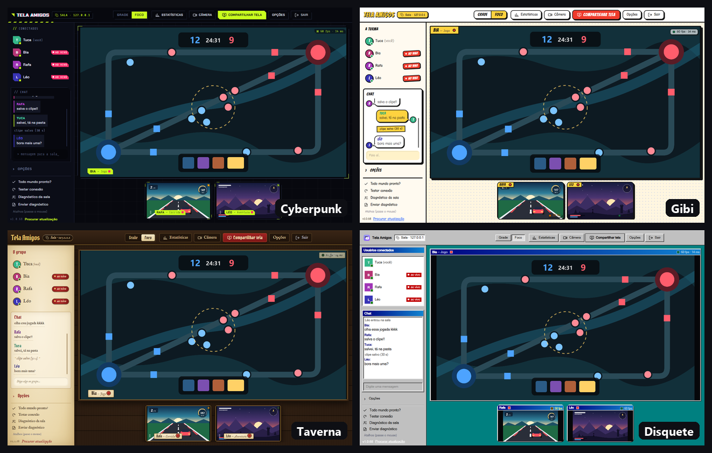

# Tela Amigos

**Share your screen with friends in 1080p at 60 fps, straight from PC to PC.** 
For playing together, watching together and showing what you're up to, with several screens at once.

English · [Português](README.pt-BR.md) · [Website](https://dollyeee.github.io/tela-amigos/)

> The app's interface is in Brazilian Portuguese.

## What it does

- **Everyone can stream at the same time.** One screen in focus and the others as thumbnails, or all of them side by side in a grid.
- **Real image quality:** 1080p at 60 fps (or your monitor's resolution), encoded on the graphics card in H.264, H.265 or AV1, with the sound of your game or PC. Discord's audio is left out, so there's no echo.
- **Straight from PC to PC**, over a **Radmin VPN** network (or Hamachi, Tailscale, your local network) or through an **online room** with a code, no VPN needed.
- **Adapts to each friend's connection:** someone on a weak network gets a lighter version, without dragging everyone else's quality down.
- **Draw, point and react** on top of a friend's screen. They see the strokes, the pointing hand and the emotes on their own monitor, over the game, without any of it showing up in the stream.
- **Save a clip** of the last 30 seconds, record with no time limit, or take a snapshot of anyone's screen.
- **Overlay:** keep a friend's screen in a small window always on top of your game.
- **Watch together:** "Todo mundo pronto?" (everyone ready?) counts down 3, 2, 1 and hits play on the video at the right moment.
- **Chat, webcam, zoom and per-friend volume** (up to 300%), with everyone's audio leveled.
- **Profile photo and interface size:** your photo shows up for your friends in place of your initial, and the whole interface can be made bigger or smaller (80% to 150%).
- **15 themes** to change the look of the app, each with its own emotes, animations and drawing style. What you put on a friend's screen (emotes, the pointing hand, pen strokes) shows up for everyone in your theme.

## Getting started

1. **Download** `TelaAmigos-Setup-x.y.z.exe` from [Releases](https://github.com/Dollyeee/tela-amigos/releases/latest) and run it. It installs just for your user, with no admin rights, and then **updates itself**.
   > The installer isn't signed with a paid certificate, so Windows may show "Windows protected your PC". Click **More info → Run anyway** (only when installing).
2. **Join a room**, in one of these ways:
   - **Radmin VPN** (best quality): everyone on the same Radmin network. One person clicks **Hospedar sala** (host a room); the others see it under **Salas abertas** (open rooms) and click **Entrar** (join). The first time, whoever hosts allows the app through the Windows firewall (tick both public and private networks).
   - **Online room** (no VPN): one person clicks **Criar sala online** (create an online room) and sends the 6-character code; the others type the code and join.
3. Click **Compartilhar tela** (share screen), pick a screen or a window, and you're live.

The first time you open the app, a short tour points out where everything is. **Como usar** (how to use), at the bottom of the start screen, shows it again.

## Themes

Click **Tema**, at the bottom of the start screen or in **Opções** (options), and pick one. It changes right away and only on your PC: each friend uses whichever they like.

  

## FAQ

<b>Do I need a good graphics card?</b>

It helps a lot: the image is encoded on the graphics card (NVIDIA, AMD or Intel), with almost no impact on your game. Without one, the processor does the work. It still works, but it's heavier, and the app tells you when that happens.

<b>Which systems does it run on?</b>

Windows 10 and 11, 64-bit.

<b>My game stutters when I stream. What can I do?</b>

Cap your game's FPS a little below your monitor's refresh rate (for example, 141 on a 144 Hz monitor). The graphics card gets some headroom and both the stream and the game run smoothly.

<b>Do my friends see my theme?</b>

The look of the app is yours alone: each friend picks their own. But the emotes, the pointing hand and the pen strokes you put on someone's screen show up for everyone in your theme, whatever theme they're using.

<b>Where does my screen go?</b>

Over Radmin, straight from your PC to each friend's, with no server in between. In an online room the video also goes directly over the internet; only the connection messages (who joined, the chat) go through the room server. If you turn on **"Servidor de vídeo quando precisar"** (video server when needed), your screen may go through a video server when your upload can't keep up with sending a copy to each friend.

<b>Something went wrong. Now what?</b>

Click **Enviar diagnóstico** (send diagnostics). The app saves a file to your Desktop with everything that helps track the problem down; send it to whoever looks after the app.

## How it works

The app is built with Electron and uses WebRTC to carry video and audio. A helper program written in C# captures the screen through Windows itself (Windows Graphics Capture or DXGI), encodes it on the graphics card through Media Foundation, and captures each program's audio separately. A Radmin room is a small server running on the host's PC; online rooms and the optional video server run on Cloudflare.

Every feature in detail, and how to build the app, is in the [LEIA-ME](LEIA-ME.md) (in Portuguese). What changed in each version is under [Releases](https://github.com/Dollyeee/tela-amigos/releases).
