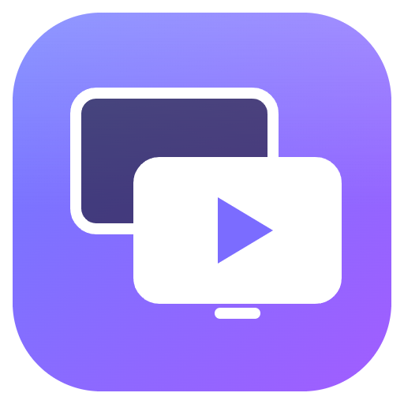
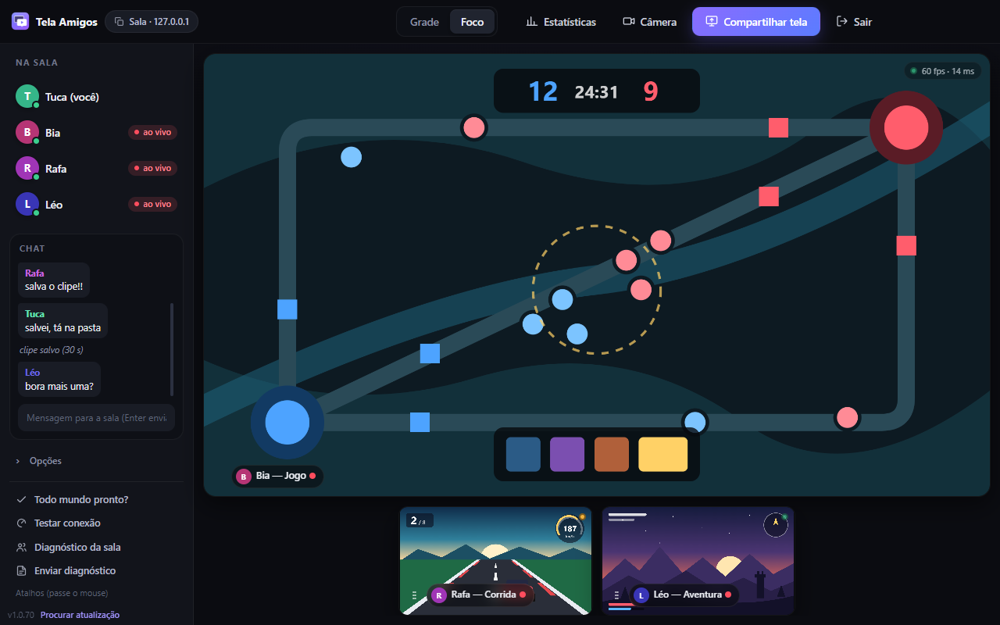
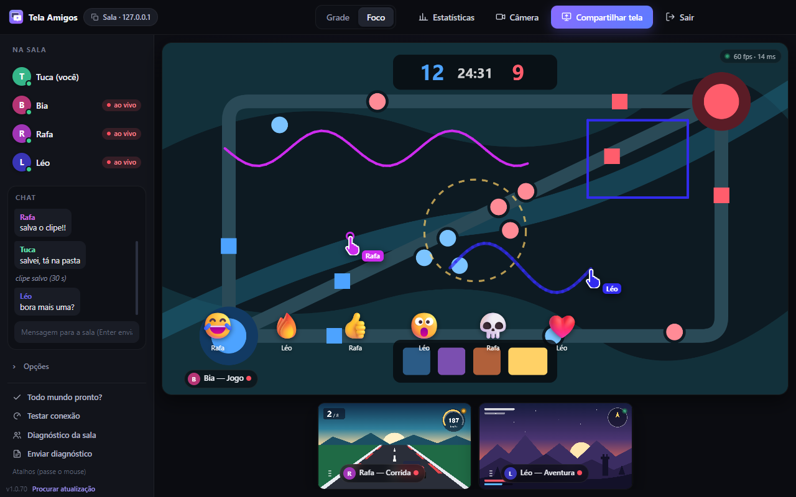
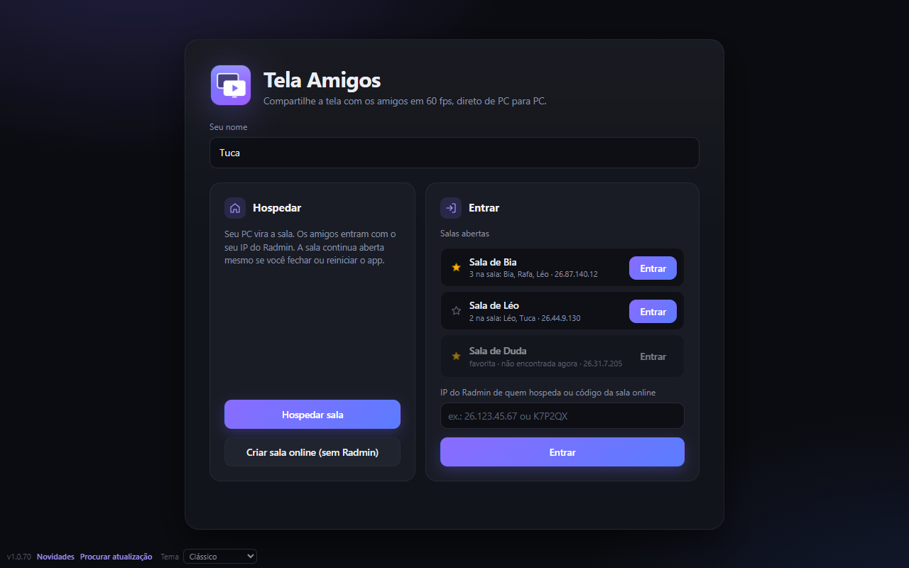
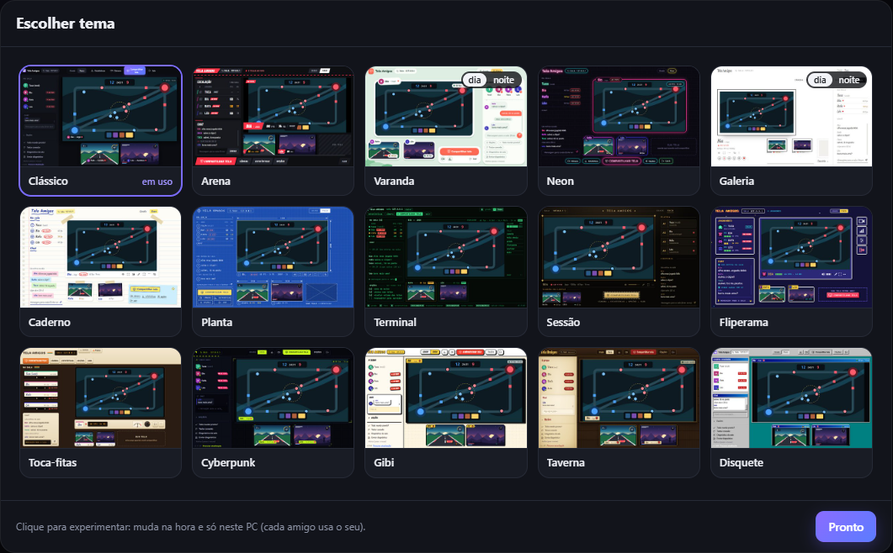
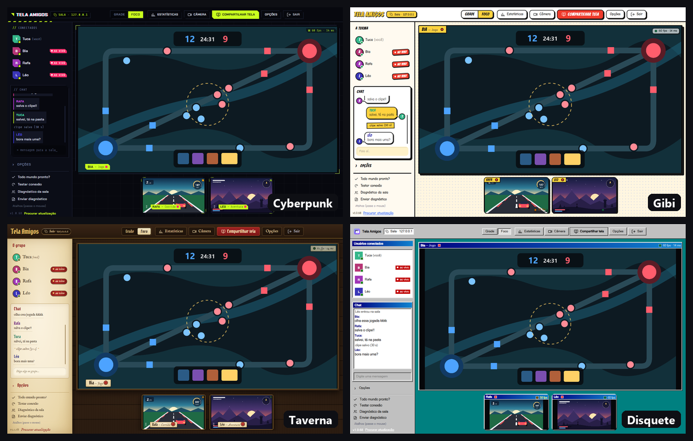

# Tela Amigos

**Compartilhe a tela com os amigos em 1080p a 60 fps, direto de PC para PC.** 
Para jogar junto, assistir junto e mostrar o que você está fazendo, com várias telas ao mesmo tempo.

[English](README.md) · Português · [Site](https://dollyeee.github.io/tela-amigos/)

## O que dá para fazer

- **Todo mundo transmite ao mesmo tempo.** Uma tela em destaque e as outras em miniatura, ou todas lado a lado na grade.
- **Imagem de verdade:** 1080p a 60 fps (ou a resolução do seu monitor), codificada na placa de vídeo em H.264, H.265 ou AV1, com o som do jogo ou do PC. O som do Discord fica de fora, para não dar eco.
- **Direto de PC para PC**, pela rede do **Radmin VPN** (ou Hamachi, Tailscale, rede local) ou por uma **sala online** com código, sem VPN nenhuma.
- **Se adapta à internet de cada amigo:** quem tem a rede fraca recebe uma versão mais leve, sem puxar a qualidade dos outros para baixo.
- **Desenhe, aponte e reaja** em cima da tela do amigo. Ele vê os riscos, a mãozinha e os emotes no próprio monitor, por cima do jogo, sem aparecer na transmissão.
- **Salve um clipe** dos últimos 30 segundos, grave sem limite de tempo ou tire uma foto da tela de qualquer um.
- **Sobreposição:** a tela de um amigo numa janelinha sempre por cima do jogo.
- **Assistir junto:** o "Todo mundo pronto?" conta 3, 2, 1 e dá play no vídeo na hora certa.
- **Chat, câmera, zoom e volume por amigo** (até 300%), com o som de todos nivelado.
- **Foto de perfil e tamanho da interface:** a sua foto aparece para os amigos no lugar da inicial, e dá para deixar tudo maior ou menor (de 80% a 150%).
- **15 temas** para mudar a cara do app, cada um com os próprios emotes, animações e jeito de desenhar. O que você põe na tela de um amigo (emotes, a mãozinha, os riscos da caneta) aparece para todos no seu tema.

## Começar

1. **Baixe** o `TelaAmigos-Setup-x.y.z.exe` em [Releases](https://github.com/Dollyeee/tela-amigos/releases/latest) e abra. Ele instala só para o seu usuário, sem pedir administrador, e depois **se atualiza sozinho**.
   > O instalador não tem assinatura digital paga, então o Windows pode mostrar "O Windows protegeu o computador". Clique em **Mais informações → Executar assim mesmo** (só na instalação).
2. **Entre numa sala**, de um destes jeitos:
   - **Radmin VPN** (a melhor qualidade): todos na mesma rede do Radmin. Uma pessoa clica em **Hospedar sala**; os outros veem a sala em **Salas abertas** e clicam em **Entrar**. Na primeira vez, quem hospeda libera o firewall do Windows (marque redes públicas e privadas).
   - **Sala online** (sem VPN): uma pessoa clica em **Criar sala online** e manda o código de 6 letras; os outros digitam o código e entram.
3. Clique em **Compartilhar tela**, escolha a tela ou a janela, e pronto.

Na primeira vez que você abre o app, um tour rápido mostra onde fica cada coisa. **Como usar**, no rodapé da tela de entrada, mostra de novo.

## Temas

Clique em **Tema**, no rodapé da tela de entrada ou em **Opções**, e escolha. Muda na hora e só no seu PC: cada amigo usa o que quiser.

  

## Perguntas

<b>Preciso de uma placa de vídeo boa?</b>

Ajuda bastante: a imagem é codificada na placa (NVIDIA, AMD ou Intel), quase sem pesar no jogo. Sem ela, o processador faz esse trabalho. Funciona, mas pesa mais, e o app avisa quando isso acontece.

<b>Funciona em qual sistema?</b>

Windows 10 e 11, de 64 bits.

<b>O jogo engasga quando eu transmito. O que faço?</b>

Limite o FPS do jogo um pouco abaixo da taxa do monitor (por exemplo, 141 num monitor de 144 Hz). A placa fica com folga e a transmissão e o jogo ficam lisos.

<b>Meus amigos veem o meu tema?</b>

A cara do app é só sua: cada amigo escolhe a dele. Mas os emotes, a mãozinha e os riscos da caneta que você põe na tela de alguém aparecem para todos no seu tema, não importa o tema de quem vê.

<b>Por onde passa a minha tela?</b>

Pelo Radmin, direto do seu PC para o de cada amigo, sem servidor no meio. Na sala online o vídeo também vai direto pela internet; pelo servidor da sala passam as mensagens de conexão (quem entrou, o chat). Se você ligar a opção **"Servidor de vídeo quando precisar"**, a sua tela pode passar por um servidor de vídeo quando o seu upload não dá conta de mandar uma cópia para cada amigo.

<b>Deu problema. E agora?</b>

Clique em **Enviar diagnóstico**. O app gera um arquivo na Área de Trabalho com tudo o que ajuda a achar o problema; mande para quem cuida do app.

## Como funciona

O app é feito em Electron e usa WebRTC para levar o vídeo e o som. Um programa auxiliar em C# captura a tela pelo próprio Windows (Windows Graphics Capture ou DXGI), codifica na placa de vídeo pelo Media Foundation e captura o som de cada programa separado. A sala pelo Radmin é um servidor pequeno que roda no PC de quem hospeda; a sala online e o servidor de vídeo opcional rodam na Cloudflare.

O detalhe de cada recurso e como desenvolver estão no [LEIA-ME](LEIA-ME.md). O que mudou em cada versão está em [Releases](https://github.com/Dollyeee/tela-amigos/releases).
